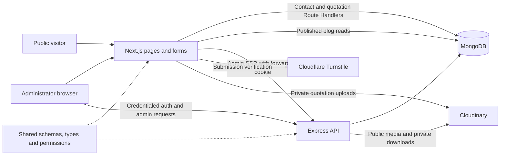

# NexaStack Technologies

**We Build Better Websites.**

NexaStack Technologies is a founder-led web development studio based in Dhaka, Bangladesh, founded by Md. Jakir Hossain. This repository contains its public business website and private administrator interface. Prospective clients in Bangladesh and abroad can explore services, read articles, contact the studio, and request a quotation. Administrators manage enquiries, quotation requests, blog content, media, and accounts.

This pnpm monorepo uses Next.js, Express, MongoDB, and a shared validation package. Marketing pages and substantial administration workflows are implemented. It is **not a verified production deployment**: email delivery is not connected, some content is demonstrative or unfinished, and production hosting and cookie configuration require decisions.

This guide describes current code, not every intention in older documents. Company facts live in [company.ts](apps/web/config/company.ts). Read the canonical [CLAUDE.md](CLAUDE.md), referenced by [AGENTS.md](AGENTS.md), before contributing.

**Primary Contact Email:** [info@nexastacktechnologies.com](mailto:info@nexastacktechnologies.com)

**Alternative Contact Email:** [info.nexastacktechnologies@gmail.com](mailto:info.nexastacktechnologies@gmail.com)

These public contact addresses are maintained in `company.email`. The domain address receives mail through Cloudflare Email Routing; these contact details do not configure or verify transactional sending identities.

## Table of contents

- [Implementation status and functionality](#implementation-status-and-functionality)
- [Technology stack](#technology-stack)
- [Architecture and data flow](#architecture-and-data-flow)
- [Repository structure](#repository-structure)
- [Local setup](#local-setup)
- [Environment variables](#environment-variables)
- [Commands](#commands)
- [Page routes](#page-routes)
- [API reference](#api-reference)
- [Database models and workflows](#database-models-and-workflows)
- [Authentication and authorization](#authentication-and-authorization)
- [Security and uploads](#security-and-uploads)
- [SEO, accessibility, and performance](#seo-accessibility-and-performance)
- [Testing and verification](#testing-and-verification)
- [Deployment](#deployment)
- [Backups and operations](#backups-and-operations)
- [Troubleshooting](#troubleshooting)
- [Known limitations and roadmap](#known-limitations-and-roadmap)
- [Contributing and licensing](#contributing-and-licensing)

## Implementation status and functionality

**Implemented** means a code path exists, not that a live service was certified. **Partially implemented** means a working portion has a gap. **Planned** identifies an explicit intention without a working feature. **Unverified** identifies an outcome this inspection cannot establish.

| Area                   | Status                | Behavior and limitations                                                                                                                                                                                                                |
| ---------------------- | --------------------- | --------------------------------------------------------------------------------------------------------------------------------------------------------------------------------------------------------------------------------------- |
| Marketing website      | Implemented           | Homepage, about, services, solutions, technologies, process, FAQ, contact, quotation, testimonials, and legal pages. Most content comes from TypeScript configuration, not a CMS.                                                       |
| Services               | Implemented           | Six listings/details: business websites; MERN/Next.js applications; admin dashboards; backend/APIs; maintenance/bug fixing; performance, SEO and accessibility audits.                                                                  |
| Solutions              | Implemented           | Five use cases: recruitment/job portals, shipping/logistics, business management, e-commerce, startup MVPs. These describe offered work, not five deployed products.                                                                    |
| Portfolio/case studies | Partially implemented | The portfolio index renders projects but is explicitly unfinished, lacks filters, and is noindex. CareerBridge has a case study, is marked in development, and has an empty screenshot array. Its external deployment was not verified. |
| Testimonials           | Partially implemented | Approved-entry rendering and service filtering exist. Current entries are fictional demo feedback with generated portraits, disclosed as demos; they are not client endorsements.                                                       |
| Contact/consultation   | Implemented           | Validated form saves an enquiry before acknowledging receipt. Phone, email, WhatsApp and consultation calls to action provide contact channels. No appointment scheduler. Email notifications are deferred.                             |
| Quotation wizard       | Implemented           | Five steps: client information, project information, requirements, budget/timeline, review/submit. Step validation, editable review, consent, tab-session draft recovery, and persisted NXQ reference. No automatic pricing/invoicing.  |
| Quotation attachments  | Implemented           | Optional PDF/PNG/JPEG uploads: five files maximum, each at most 4 MiB, uploaded separately through web to authenticated Cloudinary storage. Requires credentials; submission without files remains available.                                              |
| Public blog            | Implemented           | Published MongoDB posts, search, category/tag filters, pagination, featured/related articles, reading information, table of contents and sharing. Empty/unavailable states handle missing content or DB failures.                       |
| Blog administration    | Implemented           | Markdown authoring, preview, cover selection, tags, category creation/order/edit/delete and publishing workflows. No rich-text editor or images within Markdown bodies.                                                                 |
| Navigation/theme       | Implemented           | Responsive desktop/mobile navigation, light/dark/system themes, persisted preference before paint, WhatsApp links/widget, keyboard/focus behavior.                                                                                      |
| Admin dashboard        | Implemented           | Config-derived service/solution/project/technology counts, published blog count, submission counts, attention lists, permission-aware actions and recent activity. Counts do not imply editable CMS modules.                            |
| Enquiries              | Implemented           | Search/status/archive filters, pagination, detail, automatic new-to-read on opening, status changes, attributed notes, archive/restore and CSV export. Replies use external contact channels.                                           |
| Quotations             | Implemented           | Search/filter/pagination, requirements detail, statuses, notes, archive/restore, private downloads, contact links and CSV export. Marking a quote sent sends no email.                                                                  |
| Media library          | Implemented           | Search/filter/list/detail, upload, alt-text/description editing, URL copying, replacement, usage checks and confirmed deletion. Public marketing assets are distinct from private attachments.                                          |
| Accounts/roles         | Implemented           | First-super-admin seed, account creation, role changes, suspend/reactivate, temporary password reset, forced change and last-active-super-admin safeguards. No public registration.                                                     |
| Audit log              | Implemented           | Recorded auth/account/content/media/submission events, pagination, event/date filters and recent activity. Not a full infrastructure access log.                                                                                        |
| Password recovery      | Partially implemented | Request/token/confirmation exists; links are logged outside production. Missing delivery prevents production self-service recovery end to end.                                                                                          |
| Email notifications    | Planned               | Hooks run after persistence; neither web notifications nor API reset mail sends email. Setting RESEND_API_KEY does not enable delivery.                                                                                                 |
| Settings/broader CMS   | Planned               | A settings permission is reserved; no settings screen/API or admin CRUD for services, solutions, portfolio, technologies or testimonials.                                                                                               |
| Monitoring/hosting     | Partially implemented | Pino, health endpoints, security configuration and Speed Insights instrumentation exist. Sentry/uptime monitoring remain intentions; no committed deployment pipeline.                                                                  |
| Production readiness   | Unverified            | Live hosting, provider credentials, scheduled backups, cross-host cookies, real upload delivery, accessibility compliance and performance scores were not established.                                                                  |

Sources: [web configuration](apps/web/config), [public pages](apps/web/app/%28marketing%29), [admin pages](apps/web/app/%28admin%29/admin), and [API services](apps/api/src/services).

## Technology stack

Exact manifest pins below resolve catalog entries through [pnpm-workspace.yaml](pnpm-workspace.yaml). These are not claims about latest releases. Manifests: [root](package.json), [web](apps/web/package.json), [API](apps/api/package.json), [E2E](apps/e2e/package.json), [shared](packages/shared/package.json).

| Layer                   | Packages and versions                                                                                                                                          |
| ----------------------- | -------------------------------------------------------------------------------------------------------------------------------------------------------------- |
| Runtime/package manager | Node.js engine >=22.12.0; pnpm 11.5.2                                                                                                                          |
| Frontend                | Next.js 16.3.5; React / React DOM 19.3.0                                                                                                                       |
| Styling                 | Tailwind CSS / @tailwindcss/postcss 4.3.3; clsx 2.1.1; tailwind-merge 3.7.0                                                                                    |
| Headless primitives     | Radix Accordion 1.2.20; Dialog 1.1.23; Dropdown Menu 2.1.24                                                                                                    |
| Forms/validation        | React Hook Form 7.65.0; @hookform/resolvers 5.2.2; Zod 4.6.2 (catalog)                                                                                         |
| Database                | Mongoose 9.10.0 (catalog), both apps; MongoDB server version not pinned                                                                                        |
| API                     | Express 5.2.1; Helmet 8.3.0; cors 2.8.6; cookie-parser 1.4.7; express-rate-limit 8.7.0                                                                         |
| Auth                    | bcrypt 6.0.0; jsonwebtoken 9.0.3                                                                                                                               |
| Logs                    | Pino 10.3.1; pino-http 11.0.0; development pino-pretty 13.1.3                                                                                                  |
| Telemetry               | @vercel/speed-insights 2.0.0                                                                                                                                   |
| Language/execution      | TypeScript 6.0.3; tsx 4.23.13; @types/node 22.20.2 (catalog)                                                                                                   |
| Lint                    | ESLint / @eslint/js 9.39.5; typescript-eslint 8.70.0; eslint-config-next 16.3.5; eslint-config-prettier 10.1.8; globals 17.12.0                                |
| Format                  | Prettier 3.9.6; prettier-plugin-tailwindcss 0.8.1                                                                                                              |
| Test                    | Built-in node:test through tsx; Playwright 1.63.0; axe-core 4.13.0                                                                                             |
| Other types             | @types/react / @types/react-dom 19.3.0; @types/bcrypt 6.0.0; @types/cookie-parser 1.4.10; @types/cors 2.8.19; @types/express 5.0.6; @types/jsonwebtoken 9.0.10 |

Cloudinary and Turnstile use HTTP integrations, not vendor SDK dependencies. Account configuration is still required. Images use Next Image, fonts use next/font, and Markdown uses an in-house escaping renderer.

Although instructions mention TanStack Query, current manifests/admin code use native fetch, Server Components and refresh/revalidation helpers. TanStack Query, Sentry, an email SDK and Swagger UI are not installed/wired up. Firebase Authentication appears in the CareerBridge project description, not as this application's auth system.

## Architecture and data flow



1. Marketing pages mostly read web configuration. Public blogs read MongoDB directly through [lib/blog.ts](apps/web/lib/blog.ts), without an Express round trip.
2. Contact/quotation post to **Next.js** at `/api/contact` and `/api/quotation`. Handlers validate input/Turnstile, save, then invoke deferred notifications. Public submissions do not depend on the API host waking up; web hosting may still have startup latency.
3. `/api/quotation/upload` validates/uploads a file before final submission. Submitted attachment URLs must match the expected Cloudinary account/path.
4. Admin login/mutations call **Express** directly with credentials included. Admin Server Components forward incoming cookies for session validation and reads. No catch-all Next admin proxy exists.
5. Authenticated Next Server Actions provide blog cache invalidation, media picking and static-config reference scanning. Each checks access itself.
6. Express follows routes → middleware → controllers → services → models. [app.ts](apps/api/src/app.ts) constructs it; [index.ts](apps/api/src/index.ts) starts it, connects MongoDB and handles shutdown.

[Shared exports](packages/shared/src/index.ts) include Zod schemas, inferred types, response shapes, permissions, transitions and pure file/HTML safety helpers, without framework/DB dependencies. Each app maintains its own Mongoose models for collections it accesses; keep their shapes aligned.

## Repository structure

```text
.
├── AGENTS.md / CLAUDE.md       Entry point and canonical conventions
├── apps/
│   ├── web/
│   │   ├── CLAUDE.md
│   │   ├── app/
│   │   │   ├── (marketing)/    Public pages and dynamic details
│   │   │   ├── (admin)/admin/  Auth and (protected) admin pages
│   │   │   ├── api/            Contact, quotation, upload handlers
│   │   │   ├── dev/            Tokens and content previews
│   │   │   └── ...             Layout, sitemap, robots, icons, errors
│   │   ├── components/        ui/, layout/, sections/, admin/
│   │   ├── config/            Company and marketing content
│   │   ├── lib/               Data, admin clients/actions, helpers, models/
│   │   ├── integration/       Route Handler integration suites
│   │   ├── public/            Brand, social, demonstration assets
│   │   ├── styles/            Tokens and global Tailwind styles
│   │   ├── .env.example
│   │   └── next.config.ts     Headers and image allowlist
│   ├── api/
│   │   ├── CLAUDE.md
│   │   ├── src/
│   │   │   ├── app.ts / index.ts
│   │   │   ├── config/        Environment validation
│   │   │   ├── routes/        Paths and middleware
│   │   │   ├── controllers/   HTTP input/output
│   │   │   ├── services/      Business logic
│   │   │   ├── models/        Mongoose persistence
│   │   │   ├── middleware/    Auth, permissions, CSRF, limits, errors
│   │   │   ├── schemas/       API-local request/query schemas
│   │   │   ├── lib/           Auth, uploads, Markdown, CSV, logs, DB
│   │   │   ├── integration/   HTTP/database suites
│   │   │   └── types/         API types
│   │   ├── scripts/           Seed, backup, legacy migrations
│   │   └── .env.example
│   └── e2e/
│       ├── tests/             Browser suites
│       ├── support/           Fixtures/helpers/environment
│       ├── global-setup.ts    Isolated stack setup
│       └── playwright.config.ts
├── packages/shared/
│   ├── CLAUDE.md
│   └── src/                   schemas/, types/, constants/, utils/, test-utils/
├── scripts/
│   ├── run-integration.mjs
│   └── lib/mongod.mjs         Throwaway DB lifecycle and safeguards
├── package.json
├── pnpm-workspace.yaml
├── pnpm-lock.yaml
├── tsconfig.base.json
├── eslint.config.mjs
└── prettier.config.mjs
```

Unit tests also sit beside implementation as `*.test.ts`. Generated output, dependencies, private environments and artifacts are omitted. E2E is test-only, not a deployed application.

## Local setup

### Prerequisites

| Requirement       | Purpose                                                                              |
| ----------------- | ------------------------------------------------------------------------------------ |
| Node.js >=22.12.0 | Root engine requirement                                                              |
| pnpm 11.5.2       | Pinned package manager; use with catalog/lockfile                                    |
| MongoDB           | Local server or separate development Atlas DB; tests require local mongod regardless |
| Build network     | next/font downloads Geist during production builds; self-hosted at runtime           |
| Optional tools    | Playwright browser binaries for E2E; MongoDB Database Tools for backup/restore       |

Commands below are PowerShell-compatible, from repository root. If your Node installation includes Corepack, `corepack enable` enables package-manager shims; otherwise provision pinned pnpm separately.

```powershell
node --version
pnpm --version
pnpm install
```

Postinstall builds shared, whose exports point to compiled output. Copy examples without overwriting existing files:

```powershell
if (-not (Test-Path apps/web/.env.local)) {
    Copy-Item apps/web/.env.example apps/web/.env.local
}
if (-not (Test-Path apps/api/.env)) {
    Copy-Item apps/api/.env.example apps/api/.env
}
```

Edit these private files locally:

1. Set both `MONGODB_URI` values to the **same development database**. Web writes submissions Express manages. Never develop/test against production data.
2. Keep web `http://localhost:3000`, API `http://localhost:4000`, API `CORS_ORIGINS=http://localhost:3000`, and `WEB_APP_URL=http://localhost:3000`. Do not mix localhost and 127.0.0.1 in browser-facing URLs.
3. Set a private random API `JWT_SECRET` of at least 32 characters; no default exists.
4. Without local Turnstile, blank **both** web Turnstile fields. Verification skips with a warning in development. Otherwise configure a matching development/test pair; production requires working keys.
5. Blank Cloudinary fields unless configured. Nonempty placeholders can falsely appear configured. File operations need matching account credentials in both apps. Leave the reserved email key blank.

```powershell
pnpm dev
```

Open **http://localhost:3000**, **http://localhost:3000/admin/login**, and **http://localhost:4000/health**. API `/health/ready` is 200 only with a DB connection. Stop with Ctrl+C.

For individual workspaces, use separate terminals:

```powershell
pnpm build:shared
pnpm --filter web dev
```

```powershell
pnpm --filter api dev
```

Root dev watches shared changes. For separate apps, rebuild shared after edits or run `pnpm --filter @nexastack/shared dev` separately.

### First administrator

No real credentials/public registration are bundled. Set `ADMIN_SEED_EMAIL` and `ADMIN_SEED_PASSWORD` temporarily in the private API environment, then against your development database:

```powershell
pnpm --filter api run seed-admin
```

The [seed script](apps/api/scripts/seed-admin.ts) requires the full API environment and eight-character minimum password. It hashes the password and creates an active super_admin without forced change. It is a **no-op if any administrator exists**, not a reset command. Remove seed values afterward. Sign in at `/admin/login`; create later accounts through `/admin/users`.

## Environment variables

Use [web/.env.example](apps/web/.env.example) and [api/.env.example](apps/api/.env.example) as templates. The table contains safe examples only; never commit populated environments.

| Variable                         | Workspace          | Purpose                                              | Required/Optional                                     | Safe example                                   |
| -------------------------------- | ------------------ | ---------------------------------------------------- | ----------------------------------------------------- | ---------------------------------------------- |
| `NEXT_PUBLIC_SITE_URL`           | web                | Canonicals, metadata, sitemap and robots             | Required in production; development default           | `http://localhost:3000`                        |
| `NEXT_PUBLIC_API_URL`            | web                | Browser/SSR Express requests and CSP allowlist       | Required in production; development default           | `http://localhost:4000`                        |
| `NEXT_PUBLIC_TURNSTILE_SITE_KEY` | web                | Public verification widget                           | Needed with server key for protected forms            | Empty locally                                  |
| `GOOGLE_SITE_VERIFICATION`       | web                | Search Console verification meta tag                 | Optional                                              | Empty                                          |
| `MONGODB_URI`                    | web, api           | Same application database for both apps              | Required                                              | `mongodb://127.0.0.1:27017/nexastack_dev`      |
| `TURNSTILE_SECRET_KEY`           | web                | Verify contact/quotation tokens                      | Required for production submissions; optional locally | Empty locally; private key in production       |
| `CLOUDINARY_CLOUD_NAME`          | web, api           | Media account; web image allowlist at build/runtime  | Optional until media is used                          | `your-cloud-name`                              |
| `CLOUDINARY_API_KEY`             | web, api           | Signed upload/download operations                    | Required for media operations                         | Empty until configured                         |
| `CLOUDINARY_API_SECRET`          | web, api           | Cloudinary signing secret                            | Required for media operations                         | Empty until configured                         |
| `RESEND_API_KEY`                 | web, api           | Reserved notification hook; currently does nothing   | Optional/inert                                        | Empty                                          |
| `NODE_ENV`                       | api; web framework | Runtime mode, cookies and logging                    | API defaults to development; Next sets its mode       | `development`                                  |
| `PORT`                           | api                | HTTP listener                                        | Optional; default 4000                                | `4000`                                         |
| `CORS_ORIGINS`                   | api                | Comma-separated browser origins; also CSRF allowlist | Required                                              | `http://localhost:3000`                        |
| `JWT_SECRET`                     | api                | Signs session tokens; minimum 32 characters          | Required                                              | Generate privately; no reusable example secret |
| `WEB_APP_URL`                    | api                | Origin for reset links                               | Required                                              | `http://localhost:3000`                        |
| `LOG_LEVEL`                      | api                | Pino threshold                                       | Optional; default info                                | `info`                                         |
| `TRUST_PROXY`                    | api                | Trusted reverse-proxy hop count                      | Optional; default 0                                   | `0` locally                                    |
| `ADMIN_SEED_EMAIL`               | api seed script    | First administrator email                            | Required only when seeding                            | `admin@example.com`                            |
| `ADMIN_SEED_PASSWORD`            | api seed script    | First administrator password                         | Required only when seeding                            | Set privately, then remove                     |

`NEXT_PUBLIC_*` values are embedded in browser bundles at build time: rebuild after changing them. Never use that prefix for secrets. `GOOGLE_SITE_VERIFICATION` is deliberately emitted in public HTML despite lacking the prefix. MongoDB, JWT and signing keys stay server-side.

Test/operator controls are separate from application `.env` settings:

| Variable                        | Workspace             | Purpose                                | Required/Optional                | Safe example                        |
| ------------------------------- | --------------------- | -------------------------------------- | -------------------------------- | ----------------------------------- |
| `MONGOD_BIN`                    | scripts, e2e          | Local MongoDB executable override      | Optional                         | `C:\tools\mongodb\bin\mongod.exe`   |
| `NEXASTACK_TEST_MONGO_URI`      | integration harnesses | Throwaway server URI                   | Runner-provided; never real data | Runner-generated loopback URI       |
| `E2E_WEB_PORT` / `E2E_API_PORT` | e2e                   | Isolated app ports                     | Optional                         | `3210` / `4210`                     |
| `E2E_WORKERS`                   | e2e                   | Playwright concurrency                 | Optional; default 4              | `2`                                 |
| `E2E_REUSE_BUILD`               | e2e                   | Reuse `.next` from the same test setup | Optional; default rebuild        | `1` only for compatible test builds |
| `NEXT_TELEMETRY_DISABLED`       | E2E web process       | Disable Next telemetry during tests    | Harness-provided                 | `1`                                 |

**Example/code discrepancies:** examples contain nonempty Turnstile/Cloudinary placeholders, so copying alone is insufficient. The API example describes Cloudinary mainly as attachment retrieval, but it also powers media uploads/replacements/deletes. `RESEND_API_KEY` is read outside validated environment schemas and is inert. `COOKIE_DOMAIN`, mail-sender and Sentry settings mentioned in older intentions have no runtime implementation. Test controls above are intentionally absent from application examples.

## Commands

Run from repository root. Commands are existing package scripts unless marked `exec`.

| Command                                               | Effect / prerequisites                                                                    |
| ----------------------------------------------------- | ----------------------------------------------------------------------------------------- |
| `pnpm install`                                        | Install workspace dependencies; postinstall builds shared; requires registry access.      |
| `pnpm dev`                                            | Build shared, then watch shared, web and API.                                             |
| `pnpm --filter web dev` / `pnpm --filter api dev`     | Start one application; build shared first.                                                |
| `pnpm build:shared`                                   | Compile shared JavaScript/declarations into `packages/shared/dist`.                       |
| `pnpm --filter @nexastack/shared dev`                 | Watch shared sources.                                                                     |
| `pnpm build`                                          | Recursive production builds: shared, API and web; E2E has no build script.                |
| `pnpm --filter web build` / `pnpm --filter api build` | Individual builds; shared must already be built.                                          |
| `pnpm --filter web start`                             | Serve built Next application, normally port 3000.                                         |
| `pnpm --filter api start`                             | Run `dist/index.js`, loading API `.env` if present.                                       |
| `pnpm lint`                                           | ESLint across all workspaces, without auto-fix.                                           |
| `pnpm typecheck`                                      | Rebuild shared, generate Next route types, check all workspaces; writes generated output. |
| `pnpm format:check`                                   | Check formatting without rewriting files.                                                 |
| `pnpm format`                                         | Rewrite formatting repository-wide; avoid for single-file tasks.                          |
| `pnpm test`                                           | Rebuild shared and run unit suites via `tsx --test`.                                      |
| `pnpm test:integration`                               | Build shared; start/destroy isolated MongoDB and run API/web integration suites.          |
| `pnpm test:integration rbac csrf`                     | Run integration files matching either substring; no matches is a failure.                 |
| `pnpm test:e2e`                                       | Build shared; boot isolated stack and run Chromium tests.                                 |
| `pnpm test:e2e:full`                                  | Same setup, all configured browser/device projects.                                       |
| `pnpm --filter e2e exec playwright install chromium`  | Provision Chromium using installed Playwright CLI; requires network.                      |
| `pnpm --filter e2e exec playwright install`           | Provision engines for the full suite.                                                     |
| `pnpm --filter api run seed-admin`                    | First-account creation; writes the configured database.                                   |
| `pnpm --filter api run backup-db`                     | Manual compressed dump; needs Database Tools and full API environment.                    |

There is no root `start` script. Run web and API startup commands in separate processes.

Legacy maintenance is **not required for a fresh database**. Read [the scripts](apps/api/scripts), select the intended database, and back up before applying:

| Command                                               | Purpose / effects                                                                                                  |
| ----------------------------------------------------- | ------------------------------------------------------------------------------------------------------------------ |
| `pnpm --filter api run migrate-enquiries`             | Normalize legacy enquiry statuses/archive/note fields.                                                             |
| `pnpm --filter api run migrate-quotations`            | Normalize legacy quotation workflow fields.                                                                        |
| `pnpm --filter api run migrate-admin-users`           | Backfill account lifecycle fields.                                                                                 |
| `pnpm --filter api run migrate-quotation-attachments` | Default dry run for moving old public attachments to authenticated delivery; requires DB/Cloudinary configuration. |

The attachment script recognizes `--apply` (documented invocation: `pnpm --filter api run migrate-quotation-attachments -- --apply`). Applying changes Cloudinary assets and stored URLs; old public links stop working. It is not a backup or routine startup step.

## Page routes

Route-group directory names in parentheses are not URL segments. Unknown detail slugs return not found.

| Public route                               | Purpose / source                                                                                                |
| ------------------------------------------ | --------------------------------------------------------------------------------------------------------------- |
| `/`                                        | Homepage: services, solutions, technology, portfolio, process, demo testimonials and CTAs                       |
| `/about`                                   | Founder, values and positioning                                                                                 |
| `/services`, `/services/[slug]`            | Index/details from [services](apps/web/config/services.ts) and [details](apps/web/config/service-details.ts)    |
| `/solutions`, `/solutions/[slug]`          | Index/details from [solutions](apps/web/config/solutions.ts) and [details](apps/web/config/solution-details.ts) |
| `/portfolio`, `/portfolio/[slug]`          | Unfinished index and configured case studies; currently `/portfolio/careerbridge`                               |
| `/technologies`, `/process`                | Technology categories and delivery process                                                                      |
| `/blog`, `/blog/[slug]`                    | Published articles; list supports `q`, `category`, `tag`, `page`                                                |
| `/faq`                                     | Searchable/category-filtered questions                                                                          |
| `/testimonials`                            | Approved-entry display and service filter; disclosed demo content                                               |
| `/contact`, `/quotation`                   | Contact/consultation enquiry and quotation wizard                                                               |
| `/privacy-policy`, `/terms-and-conditions` | Legal information; no `/legal/[slug]` implementation                                                            |
| `/sitemap.xml`, `/robots.txt`              | Generated crawler metadata                                                                                      |

Service slugs: `business-websites`, `mern-nextjs-applications`, `admin-dashboards`, `backend-and-apis`, `maintenance-and-bug-fixing`, `performance-seo-audits`.

Solution slugs: `recruitment-job-portals`, `shipping-logistics-systems`, `business-management-apps`, `ecommerce-platforms`, `startup-mvp-development`.

| Admin route                                         | Access / behavior                                       |
| --------------------------------------------------- | ------------------------------------------------------- |
| `/admin/login`                                      | Public login form                                       |
| `/admin/forgot-password`, `/admin/reset-password`   | Recovery forms; delivery incomplete                     |
| `/admin/change-password`                            | Session required, including temporary-password accounts |
| `/admin`                                            | Protected dashboard; sections depend on capabilities    |
| `/admin/enquiries`, `/admin/enquiries/[id]`         | `manage:enquiries`                                      |
| `/admin/quotations`, `/admin/quotations/[id]`       | `manage:quotations`                                     |
| `/admin/blog`                                       | Post list; content editors see drafts only              |
| `/admin/blog/new`                                   | Create draft                                            |
| `/admin/blog/[id]/edit`, `/admin/blog/[id]/preview` | Authorized editing/preview                              |
| `/admin/blog/categories`                            | Action-specific category permissions                    |
| `/admin/media`, `/admin/media/[id]`                 | `media:read`; mutations require additional capabilities |
| `/admin/users`                                      | `manage:admins`                                         |
| `/admin/activity`                                   | `audit:view`                                            |

Developer tools: `/dev/tokens`, `/dev/blog-preview`, `/dev/blog-post-preview`, `/dev/testimonials-preview`. [The dev layout](apps/web/app/dev/layout.tsx) returns 404 in production. There are no implemented `/admin/projects` or `/admin/settings` pages.

## API reference

The public submission paths below belong to **web**; Express uses the separate API origin. JSON responses use:

```json
{ "success": true, "data": {} }
```

```json
{
  "success": false,
  "error": {
    "code": "VALIDATION_ERROR",
    "message": "Check the submitted information.",
    "details": []
  }
}
```

`details` is optional and may identify validation locations/paths. CSV exports and attachment downloads return files on success, not JSON. Errors use the envelope where possible. Common statuses: 200/201 success, 400 invalid input, 401 no session, 403 denied/CSRF/password change required, 404 missing, 409 conflict/invalid transition, 410 retired, 413 too large, 429 rate limit, 500 internal error, 503 unavailable.

Shared Zod schemas validate public forms/domain inputs; API-local schemas validate queries, pagination and MongoDB IDs. Multipart handlers validate fields/file bytes separately. Client validation is not authorization.

### Public and health endpoints

| Host | Method | Path                    | Behavior / access                                                                                              |
| ---- | ------ | ----------------------- | -------------------------------------------------------------------------------------------------------------- |
| web  | POST   | `/api/contact`          | Public JSON + `turnstileToken`; save enquiry, return 201 `{ received: true }`                                  |
| web  | POST   | `/api/quotation`        | JSON + `turnstileToken`, exact Origin and UUID `X-Submission-Id`; attachment ownership checked; return 201 `{ referenceNumber }` |
| web  | POST   | `/api/quotation/upload` | Session-authorized multipart `file` plus `X-Upload-Id`; shared limits; returns `{ url, name, size }` |
| web  | POST   | `/api/quotation/upload/authorize` | Separate Turnstile verification; issues/renews HTTP-only upload permission |
| web  | POST / DELETE | `/api/quotation/upload/session` | Restore owned files / remove a file from the draft |
| web  | POST   | `/api/quotation/upload/cleanup` | Server-only bearer secret; leased, bounded cleanup/recovery |
| api  | GET    | `/health`               | Process liveness, no database dependency                                                                       |
| api  | GET    | `/health/ready`         | Database connection/ping; 503 until ready                                                                      |
| api  | POST   | `/api/v1/contact`       | Retired: validation/rate limiting remain; valid requests return 410 `ENDPOINT_RETIRED`; use web `/api/contact` |

There is no Express public quotation-submission route. Next Server Actions are framework-managed POSTs, not additional stable REST paths.

### Authentication and dashboard

All Express paths below are prefixed by `/api/v1`. Every mutation requires an allowed `Origin` and `X-Requested-With: nexastack-admin`, including login/reset requests. Browser requests use `credentials: 'include'`.

| Method | Path after `/api/v1`           | Requirement / behavior                                                            |
| ------ | ------------------------------ | --------------------------------------------------------------------------------- |
| POST   | `/auth/login`                  | Credentials, CSRF, login limiter; sets cookie                                     |
| POST   | `/auth/logout`                 | Session, CSRF; revokes current session                                            |
| GET    | `/auth/session`                | Session; current identity                                                         |
| POST   | `/auth/change-password`        | Session, current/new passwords, CSRF, limiter                                     |
| POST   | `/auth/password-reset/request` | Email, CSRF, limiter; generic response regardless of account existence            |
| POST   | `/auth/password-reset/confirm` | Valid one-use token/new password, CSRF                                            |
| GET    | `/auth/activity`               | Session + `audit:view`; event/date/page filters                                   |
| GET    | `/admin/dashboard/stats`       | Session + either `manage:enquiries` or `manage:quotations`; permitted counts only |
| GET    | `/admin/activity/recent`       | Session + `audit:view`                                                            |

### Enquiries and quotations

For each row, substitute `module` with **`enquiries` or `quotations`**. Prefix: `/api/v1/admin`. All require a session and the corresponding `manage:enquiries` or `manage:quotations` capability.

| Method | Path after `/api/v1/admin`                  | Behavior                                                                                |
| ------ | ------------------------------------------- | --------------------------------------------------------------------------------------- |
| GET    | `/{module}`                                 | Search/filter/page list                                                                 |
| GET    | `/{module}/export`                          | Filtered CSV, no pagination; refuses over 5,000 rows; internal notes excluded           |
| GET    | `/{module}/:id`                             | Detail; enquiry opening marks `new` as `read`; quotation opening does not change status |
| PATCH  | `/{module}/:id/status`                      | Shared transition table enforced                                                        |
| POST   | `/{module}/:id/notes`                       | Append attributed internal note                                                         |
| PATCH  | `/{module}/:id/archive`                     | Archive independently of status                                                         |
| PATCH  | `/{module}/:id/unarchive`                   | Restore to active list                                                                  |
| GET    | `/quotations/:id/attachments/:attachmentId` | Authorized private download belonging to this request                                   |

### Blog, media and accounts

All paths below follow `/api/v1/admin`; all require a valid session. Content-editor restrictions also apply inside services.

| Method | Path                                       | Required capability / behavior                                                               |
| ------ | ------------------------------------------ | -------------------------------------------------------------------------------------------- |
| GET    | `/blog/posts`                              | `content:edit`; filter/page posts                                                            |
| POST   | `/blog/posts`                              | `content:create`; always creates a draft                                                     |
| GET    | `/blog/posts/:id`                          | `content:edit`; editors restricted to drafts                                                 |
| PATCH  | `/blog/posts/:id`                          | `content:edit`; non-draft additionally needs `content:publish`; restore archived posts first |
| DELETE | `/blog/posts/:id`                          | `content:delete`; draft/archived only                                                        |
| POST   | `/blog/posts/:id/status`                   | `content:publish`; publish, unpublish, archive or restore                                    |
| GET    | `/blog/categories`                         | `content:edit`                                                                               |
| POST   | `/blog/categories`                         | `content:create`                                                                             |
| PUT    | `/blog/categories/order`                   | `content:publish`; complete ordered ID list                                                  |
| PATCH  | `/blog/categories/:id`                     | `content:publish`                                                                            |
| DELETE | `/blog/categories/:id`                     | `content:delete`; must have no posts                                                         |
| GET    | `/media`, `/media/:id`, `/media/:id/usage` | `media:read`                                                                                 |
| POST   | `/media`                                   | `manage:media`; multipart upload                                                             |
| PATCH  | `/media/:id`                               | `manage:media`; descriptive fields                                                           |
| POST   | `/media/:id/replace`                       | `manage:media`; multipart replacement                                                        |
| DELETE | `/media/:id`                               | `media:delete`; confirmation and usage safeguards                                            |
| GET    | `/users`                                   | `manage:admins`; account list                                                                |
| POST   | `/users`                                   | `manage:admins`; temporary password returned once                                            |
| PATCH  | `/users/:id/role`                          | `manage:admins`; account safeguards                                                          |
| PATCH  | `/users/:id/status`                        | `manage:admins`; active/suspended                                                            |
| POST   | `/users/:id/reset-password`                | `manage:admins`; temporary password/session revocation                                       |

API documentation consists of `@openapi` comments in [route files](apps/api/src/routes), [shared schemas](packages/shared/src/schemas), and [API-local schemas](apps/api/src/schemas). No Swagger UI or generated OpenAPI document is mounted. Actual registrations take precedence over stale annotation wording.

## Database models and workflows

[API models](apps/api/src/models) define nine models. [Web models](apps/web/lib/models) mirror contact/quotation persistence and read blog collections. MongoDB stores records/asset references; Cloudinary holds file bytes.

| Model                 | Purpose / relationships / indexes                                                                                                                                                                         |
| --------------------- | --------------------------------------------------------------------------------------------------------------------------------------------------------------------------------------------------------- |
| `AdminUser`           | Unique normalized email, hidden password hash, role, active/suspended state, forced-change flag, creator reference and last login                                                                         |
| `AdminSession`        | User reference, unique session ID, expiry/revocation; TTL expiry and user/revocation indexes                                                                                                              |
| `PasswordResetToken`  | User reference, unique token hash, expiry/used time; TTL expiry index; no raw reset token stored                                                                                                          |
| `AdminActivityLog`    | Actor or attempted email, event, IP/user agent, metadata/time; timestamp, actor/time and event/time indexes                                                                                               |
| `ContactSubmission`   | Contact fields/consent, status, archive flag, embedded attributed notes; timestamp and archive/status/time indexes                                                                                        |
| `QuotationSubmission` | Client/project/requirements/budget/timeline/consent, reference, attachment URLs, workflow/notes; reference and list indexes                                                                               |
| `BlogPost`            | Category, tags, Markdown, derived HTML/TOC, Media cover reference + URL snapshot, status/dates, creator/editor; unique slug, status/date, category/status, update-time and sparse cover-reference indexes |
| `BlogCategory`        | Name, unique slug, indexed display order; explicit `blogcategories` collection                                                                                                                            |
| `Media`               | Public URL/unique Cloudinary ID, type/size/dimensions, alt text or description, uploader/replacement date; explicit `media` collection and list indexes                                                   |

Enquiries use `new`, `read`, `contacted`, `closed`. Opening a new enquiry atomically marks it read and audits it. Manual transitions cannot target `new`. Quotation states are `new`, `reviewing`, `quote-sent`, `accepted`, `declined`, `closed`; backward moves are explicit in [quotationStatus.ts](packages/shared/src/constants/quotationStatus.ts). This pipeline exists, although its source comment still calls the enum a draft pending business confirmation. Status changes/notes do not contact the client.

Archiving is independent, reversible and preserves history. Notes are append-only and attributed to the administrator. Services tolerate/map legacy `responded` values; maintenance scripts normalize stored data.

Blog transitions: draft → published/archived; published → unpublished/archived; unpublished → published/archived; archived → draft. First publication fixes `publishedAt` and locks the slug. Categories in use cannot be deleted. Cover replacement updates referencing blog URL snapshots; a referenced cover cannot be deleted. Static-config media reference checks are best-effort and cannot discover every external use.

Public blog queries filter by published status, use lean reads, and derive the founder byline from company configuration. Display dates fall back to creation time if a legacy record lacks a publication date. Search/pagination happens in memory over cached summaries (nine posts/page), not a full-text search index. Reads have a one-hour tagged cache; authenticated admin Server Actions expire it after changes. Invalidation is best-effort: a failed action or direct API write can leave cached content until expiry. Session/token TTL deletion is housekeeping; authentication checks expiry explicitly.

## Authentication and authorization

[Auth services](apps/api/src/services/auth.service.ts) use bcrypt cost 12 and an eight-hour JWT backed by an `AdminSession`. Protected requests verify the token, session expiry/revocation and current account. There is no refresh-token flow; sign in after expiry. Logout revokes the session and clears its cookie.

`nexastack_admin_session` is HTTP-only, `SameSite=Lax`, path `/`, Secure in production, and currently has **no Domain attribute**. JWTs are not stored in localStorage or returned as normal JSON credentials. See deployment before splitting hosts.

Password changes require the current password, clear `mustChangePassword`, and revoke other sessions while preserving the current one. Created/reset accounts receive a generated temporary password once; convey it privately. Until changed, only session checking, logout and password change are available. Suspension revokes sessions; role changes apply through the current account on subsequent requests. Safeguards reject self-suspension/self-role-change and suspension/demotion of the last active super administrator; administrative reset also refuses resetting oneself.

Self-service reset persists a hashed, one-use token valid for one hour and responds generically. Confirmation consumes it and revokes sessions. **No reset email is sent.** The link is logged only outside production; production recovery delivery remains incomplete.

Permissions come from [one shared map](packages/shared/src/constants/permissions.ts):

| Capability                              | super_admin | admin | content_editor        |
| --------------------------------------- | ----------- | ----- | --------------------- |
| `manage:admins`                         | Yes         | No    | No                    |
| `settings:manage` (reserved)            | Yes         | No    | No                    |
| `manage:enquiries`, `manage:quotations` | Yes         | Yes   | No                    |
| `media:read`                            | Yes         | Yes   | Yes                   |
| `manage:media`, `media:delete`          | Yes         | Yes   | No                    |
| `content:create`, `content:edit`        | Yes         | Yes   | Drafts only for posts |
| `content:publish`, `content:delete`     | Yes         | Yes   | No                    |
| `audit:view`                            | Yes         | Yes   | No                    |

Content editors can create categories but cannot rename/reorder/delete them. Server checks are authoritative; hidden controls are convenience. CSRF uses exact origin plus custom header, not a double-submit token.

## Security and uploads

Implemented protections include Zod validation, Mongoose constraints, explicit query construction, API `sanitizeFilter`/`strictQuery`, permissions and safe client-facing errors. Markdown rendering escapes untrusted content; public article HTML also passes a shared allowlist. URL helpers reject unsafe protocols and restrict media/attachment references to expected paths.

| Surface                           | Protection / limitation                                                                                               |
| --------------------------------- | --------------------------------------------------------------------------------------------------------------------- |
| Contact and quotation submissions | 10 requests/IP/15 minutes each; server-side Turnstile on final submit                                                 |
| Quotation upload                  | Turnstile-issued session, exact Origin, MongoDB quotas/limits and daily budgets; byte/size validation |
| Login/password change             | 5 requests/IP/15 minutes                                                                                              |
| Reset request                     | 3 requests/IP/hour                                                                                                    |
| Rate-limit storage                | Upload authorization/requests and the additional quotation budget use MongoDB; other existing limiters remain per-process |
| Express HTTP                      | Helmet, explicit credentialed CORS, bounded JSON parser, request IDs, no-store auth/admin responses                   |
| Web HTTP                          | CSP, frame denial, nosniff, referrer/permissions policies, production HSTS; [next.config.ts](apps/web/next.config.ts) |
| CSP limitation                    | Static policy permits inline scripts/styles; not a complete inline-script injection defense                           |
| CSV                               | Quoting, UTF-8 BOM and formula-injection protection; exported client data still needs private handling                |

Production without a Turnstile secret fails closed with 503. Unset development verification warns and skips. Configure widget/secret together. Web trusts proxy IP headers; API uses `TRUST_PROXY`. Deployment must ensure those represent the trusted proxy chain.

| Upload class          | Types / limits / storage                                                                                            |
| --------------------- | ------------------------------------------------------------------------------------------------------------------- |
| Quotation attachments | PDF, PNG, JPEG; five files maximum, 4 MiB each; authenticated Cloudinary, unsigned canonical references in MongoDB |
| Media library         | JPEG, PNG, WebP and PDF up to 10 MiB; SVG up to 1 MiB; public Cloudinary assets                                     |

Detection uses actual signatures, not claimed MIME/extensions. Media filenames remove path/control characters and receive the detected extension. Image alt text is required; document description is optional. Library raster images are capped at 2400 pixels per side and use automatic format/quality delivery. SVG handling rejects scripts, handlers, foreign documents, entities and unsafe external references: a conservative text reject-list, **not a complete XML sanitizer**.

Private downloads verify session/capability and request attachment, restrict the stored URL, check fetched bytes/size, and return a download with `nosniff` and private/no-store headers, without reusable signed URLs. Quotation uploads cap the entire request stream before multipart parsing and then validate each file; API media parsing also caps the stream. Hosting request limits still matter. No antivirus scanner is implemented. Tracked quotation uploads have automatic cleanup as described below.

API HTTP logs omit sensitive bodies/cookies; ordinary account queries exclude password hashes. Never log keys, passwords, tokens or entire submissions. Exceptions matter: development reset links contain a token; reset-request logs include email; web uses console logs and development contact notifications include subject. Treat logs as private and define retention/access policies. These protections do not establish complete security.

### Quotation attachments on Netlify Free

- **Maximum individual quotation attachment size: 4 MiB (4,194,304 bytes).** Customer-facing help calls this “4 MB”. PDF, PNG and JPEG remain supported, with five attachments maximum.
- **Hosting: Netlify Free. Storage: Cloudinary.** Each file is uploaded in its own request to the existing Next.js Route Handler; final quotation JSON contains URLs only, not file bytes. Uploads are never routed through Render.
- **Whole multipart request cap: 4,210,688 bytes** (4 MiB plus 16 KiB for boundaries, filenames and other multipart overhead). The browser measures the serialized body before sending it. The server checks Content-Length when supplied and independently counts streamed bytes before parsing; it accepts exactly one file field. Missing or false Content-Length cannot bypass the cap.
- [Netlify documents](https://docs.netlify.com/build/functions/configuration/) a 6 MB buffered payload limit and an effective binary limit of approximately 4.5 MB due to Base64 overhead. Our whole-body cap encodes to 5,614,252 bytes, leaving 385,748 bytes below even a decimal 6,000,000-byte budget for the platform envelope. This is a conservative application budget, not a measurement of Netlify's actual invocation envelope. Verify exact-limit uploads on the deployed adapter before launch.
- Oversized files are rejected before upload; excessive multipart overhead asks the visitor to shorten the filename. Requests reaching the handler return 413 for excessive size. Netlify may reject larger requests before application code runs; the browser handles non-JSON platform 413 responses too.
- Cloudinary uploads remain signed, authenticated and private, with a 20-second upstream deadline inside Netlify's documented 60-second function limit. No attachment reference is returned on storage failure. Small bounded buffers are still used for parsing and file-byte validation.
- Existing private attachments up to the historical 10 MiB limit remain downloadable through the authorized Express endpoint. The media library's separate 10 MiB policy is unchanged. No database migration is needed.
- Uploads now require a durable, Turnstile-verified session; see the security and deployment instructions below. The previous process-local upload limiter is no longer the enforcement mechanism.

### Secure quotation upload lifecycle

1. The visitor clicks **Enable or renew attachments** and completes a separate Turnstile widget with action `quotation-upload`. `/api/quotation/upload/authorize` verifies Siteverify success, the hostname derived from `NEXT_PUBLIC_SITE_URL`, and that action. Upload authorization never skips verification in development. A token hash is recorded before Siteverify, preventing concurrent reuse; final quotation submission uses its own fresh widget/token.
2. A cryptographically random 256-bit credential is delivered only in an HTTP-only, SameSite=Strict cookie (Secure and `__Host-` prefixed in production). MongoDB stores its SHA-256 hash, purpose, expiration, quotas, and assets. Default upload permission lasts 10 minutes; a fresh challenge renews the same unfinished draft without resetting quotas. Cookie retention permits refresh/recovery but does not extend server-side permission.
3. The browser uploads one file at a time. The endpoint checks the exact configured Origin, authorization, shared limits, body size, actual file bytes, and an upload UUID. One atomic MongoDB reservation enforces five active attachments, 20 MiB cumulative reserved bytes, 20 lifetime reservations, and one in-flight upload. Removal frees a file slot but never refunds cumulative bytes; repeatedly replacing files cannot create unbounded storage. Uncertain failures consume their reservation until cleanup rather than risk undercounting remote assets. A five-minute lease bounds interrupted uploads; further requests can proceed after it expires within the remaining quota.
4. Each reservation records a random `nexastack/quotations/q_<32 hex>` public ID **before** Cloudinary is called. PDF/PNG/JPEG are uploaded using Cloudinary's `image` resource type, `authenticated` delivery and `overwrite=false`. Metadata persistence failure or function termination therefore leaves a known asset for cleanup. A repeated upload UUID returns an already confirmed result rather than uploading again; a session-state refresh recovers successful uploads whose response was lost.
5. Final submission still verifies Turnstile. Submitted URLs must match uploaded, unexpired assets in the current session. A single-document compare-and-set freezes the validated payload and selected assets in `finalizing`, with a preallocated quotation ObjectId/reference. An idempotent quotation upsert follows, then selected assets become `committed` and permission is closed. This durable outbox avoids a multi-document transaction requirement. A crash is recovered by retry or cleanup; finalizing records are never eligible for asset deletion. Plain submissions use a separate random submission nonce; retry returns the same reference only for the same validated payload. No-attachment submissions also revoke unused permission.
6. Temporary assets expire 24 hours after successful upload by default. Session cleanup waits until the latest asset retention expires. Removed assets also await this conservative retention period. Cleanup atomically leases a session, checks actual quotation references before deleting, uses signed Cloudinary `image/destroy` with the stored public ID and authenticated delivery type, and records each deletion. `not found` is success. Failures retain metadata and retry after 15 minutes; interrupted cleanup leases expire after five minutes. Fully reconciled records receive a 30-day metadata TTL. Empty sessions receive a retention-window TTL which is atomically removed before any asset upload; they cannot crowd out the cleanup queue. Legacy/untracked uploads and unrelated media are never swept.

**Shared rate limits:** `uploadlimits` uses atomic fixed-window counters and unique `_id` keys, with a TTL index for obsolete windows/challenge hashes. Default site-wide budgets per 15 minutes are 120 authorization attempts, 30 verified session issuances/renewals, and 600 upload/session requests. Authenticated sessions additionally permit 20 upload requests and 60 status/removal requests per window. Final submissions have a shared 120-request budget in addition to their existing limiter. All forwarded IP headers are ignored by upload security; no IP addresses are retained. Additional UTC-day budgets cap uploads at 100 files and 100 MiB across the whole site, including uncertain remote attempts; verified sessions cannot bypass them. Known failures before contacting Cloudinary release their session reservation. Global limits avoid spoofable identities but can be exhausted by an attacker, temporarily affecting legitimate visitors. Adjust the documented budgets to observed traffic, and use provider-level abuse controls if needed. Fixed windows allow bursts around a boundary.

**Database setup:** Mongoose initializes indexes before upload state is used. `quotationuploads` has a unique token-hash index, a cleanup state/retention/lease index and conditional `purgeAt` TTL. `uploadlimits` has a TTL index. Both quotation models now declare an `attachments` index for cleanup's reference check. The deployment database user needs collection/index creation and CRUD permissions on this database. No customer-data migration or cleanup of historical assets is performed. Pre-deployment in-progress attachment URLs cannot prove new ownership: visitors must remove and re-upload them. The new session collection temporarily contains the validated quotation payload only while finalization is recovering; it is removed after commitment.

### Enable scheduled cleanup on Netlify Free

[Netlify Scheduled Functions](https://docs.netlify.com/build/functions/scheduled-functions/) are available on all plans, have a 30-second execution limit, run automatically only on published production deploys, and cannot be invoked directly at a URL. This repository provides `netlify/functions/quotation-cleanup.mjs`, scheduled every 15 minutes, and `netlify.toml` declares its directory. It calls the protected Next.js cleanup endpoint; Render availability is irrelevant.

1. In Netlify, use the **repository root as Base directory**, `apps/web` as Package directory, `pnpm --filter @nexastack/shared build && pnpm --filter web build` as Build command, and `apps/web/.next` as Publish directory. Use the automatic Next.js adapter and Node 22.12+ (the repository has been tested with Node 22.23.1). Keep the functions directory from `netlify.toml`.
2. Configure the existing MongoDB and Cloudinary credentials in Netlify's environment-variable settings for Functions. Set public build variables for Builds too. The API uses the same Cloudinary account for authorized admin downloads. Do not create an unsigned preset.
3. Set `NEXT_PUBLIC_SITE_URL` to the exact canonical HTTPS origin. In Cloudflare Turnstile, allow that hostname and provision the existing public site key/private secret. Canonicalize alternate hosts before visitors use the form; do not trust the request Host header to widen the allowlist. Upload and final verification use separate tokens. Test keys are for isolated test environments only.
4. Generate a random cleanup secret (for example locally with `node -e "console.log(require('node:crypto').randomBytes(32).toString('hex'))"`). Save it as `QUOTATION_CLEANUP_SECRET` in Netlify for Functions, shared by the scheduled trigger and Next.js runtime. Never put it in public variables or a public cron URL. Optional limits/defaults are listed in `apps/web/.env.example`.
5. Publish a production deploy. Open Netlify's Functions panel, select `quotation-cleanup`, confirm its schedule and use **Run now**. Check both the scheduled-function log and the worker's `[quotation-cleanup]` aggregate counts. A nonzero failure count returns 503 so the scheduled invocation is visibly failed. Scheduling has not been enabled or verified on your account by this implementation.
6. In a separate staging database/Cloudinary account, verify an exact-4-MiB upload, five sequential uploads, expiration/renewal, refresh recovery, final submission and authorized admin download. Exercise cleanup on deliberately expired synthetic assets; confirm committed files remain. Do not shorten production retention just to run a test.

**Operations and limitations:** Batches default to two sessions and an 18-second work budget (each deletion has a five-second deadline); the trigger has a 25-second deadline. DB outages may exceed that budget, but leases and idempotent operations preserve recovery. Track failed invocations and backlog: a disabled schedule, paused/exhausted free plan, unavailable database or storage can delay cleanup indefinitely. Pending finalizations remain protected and require operator investigation if they repeatedly fail. Free-tier operations/storage quotas still apply, challenges are not proof of a customer's identity, and magic-byte checks are not malware scanning. One browser cookie represents one upload draft; simultaneous tabs share it. Renew permission if it expires. Renewal does not reset quotas: after exhausting the allowance, submit without further files or wait for retention to expire before authorizing a fresh draft. No live deployment, real deletion, or full browser-to-Cloudinary verification is implied by local tests.

## SEO, accessibility, and performance

Next metadata includes canonical paths, Open Graph/Twitter cards and shared helpers. Detail metadata derives from content. JSON-LD includes organization, service, article and breadcrumb information where applicable. Social cards use existing assets/blog-cover URLs; no OG-image generation endpoint is implemented. Search Console verification emits a meta tag only when configured.

[Sitemap](apps/web/app/sitemap.ts) combines the route registry, services/solutions, project/case-study intersections and published posts. It runs per request; static entries remain if blog reads fail. The unfinished portfolio index is noindex/excluded, while its actual case study is included. [Robots](apps/web/app/robots.ts) disallows `/admin`, `/api/` and `/dev`; robots rules are not access control.

Components include semantic landmarks, labelled forms/linked errors, keyboard-operable Radix controls, visible focus styles, skip-link/route focus handling, responsive navigation, image alternatives and global reduced-motion rules. Themes use early initialization to reduce flashing. **WCAG 2.1 AA is a target, not certified compliance**; axe cannot establish screen-reader usability or every visual/context issue.

Server Components keep most marketing rendering off the client. Next Image reserves dimensions and optimizes allowlisted images; Geist uses `next/font`; Cloudinary optimizes library rasters. Blog caching is described above; auth/admin responses and reads avoid shared caching. Speed Insights is instrumented, but no performance score or live telemetry result is established here.

## Testing and verification

| Tier         | Tools / coverage                                                                                                                                             | Prerequisites and limitations                                                                             |
| ------------ | ------------------------------------------------------------------------------------------------------------------------------------------------------------ | --------------------------------------------------------------------------------------------------------- |
| Unit         | `node:test` via tsx; shared schemas/transitions/file/HTML helpers, web theme/WhatsApp/notifications/routes, API permissions/queries/CSV/uploads/auth helpers | No real DB/browser; some focused HTTP tests bypass session gates or inject dependencies                   |
| Integration  | Real Express HTTP/local MongoDB; auth, roles, CSRF, injection, publishing, workflows/accounts; real web contact/quotation handlers                           | Local `mongod`; Cloudflare verification stubbed; failure-path tests intentionally stub persistence errors |
| Browser fast | Playwright Chromium: crawl, SEO, axe, forms, themes, responsive layouts, admin roles/publication                                                             | Local MongoDB, browser binaries, production web build, font/Turnstile network access                      |
| Browser full | Also Firefox, WebKit, Pixel 7, iPhone 14 and iPad Mini projects                                                                                              | Engine binaries; device profiles are emulation, not physical devices                                      |

[The runner](scripts/run-integration.mjs) starts [throwaway MongoDB](scripts/lib/mongod.mjs) in a temporary directory. Harnesses require plain `mongodb://`, loopback hosts and database names ending `_test`; remote/Atlas databases are refused. Test files use synthetic databases. E2E supplies explicit test environments and blanks provider credentials instead of using real application values. Never override safeguards to use production.

The browser harness starts API/production Next, creates synthetic accounts/content and overwrites `apps/web/.next`. Default isolated ports: 3210/4210. Artifacts include `apps/e2e/.logs`, auth state and failure traces/screenshots. Browser Turnstile tests use test keys and visibly skip when Cloudflare is unreachable. Reusing an ordinary build with `E2E_REUSE_BUILD=1` invalidates isolation because public variables are compiled in.

No suite proves real email delivery, real Cloudinary account behavior, production multi-host cookies, automated restore readiness or screen-reader usability. Unit signing/validation tests are not provider integration tests. Historical `phase2-tests.log` / `phase3-tests.log` files are not results of this inspection.

This documentation update ran local lint/type checking; no database, upload, email, migration or deployment operation was performed. The task completion report records exact outcomes.

## Deployment

Project instructions intend Vercel (web), Render (API), Atlas (database), Cloudinary (media). **No Vercel/Render manifest, Dockerfile or CI deployment workflow is committed**, and no live deployment is verified here. Present configuration is application-level: Next headers/images, workspace builds, API environment validation, proxy trust, health checks and shutdown.

Settings derived from current scripts, with **repository root** as build working directory:

| Service    | Build / start settings                                                                                                                                                                                                                      |
| ---------- | ------------------------------------------------------------------------------------------------------------------------------------------------------------------------------------------------------------------------------------------- |
| Web        | Install `pnpm install --frozen-lockfile`; run `pnpm build:shared`, then `pnpm --filter web build`; generic Node hosting starts `pnpm --filter web start`. Vercel needs its Next monorepo adapter/root settings and shared workspace access. |
| API        | Install including build tools; run `pnpm build:shared`, then `pnpm --filter api build`; start `pnpm --filter api start`; respect platform `PORT`.                                                                                           |
| MongoDB    | Both apps use the same environment database; configure network access/credentials. Server version/tier not pinned.                                                                                                                          |
| Cloudinary | Same credentials on both servers; web cloud name at build/runtime. Private quotation and public media use different delivery types.                                                                                                         |

These are settings to configure/test, not a completed deployment. Preserve workspace dependencies/shared `dist` in runtime artifacts; copying API `dist` alone is insufficient. Web Route Handlers require Node/TCP for Mongoose; static export cannot replace this application.

Set production origins before building, runtime secrets, working Turnstile keys, HTTPS, API `NODE_ENV=production`, exact `CORS_ORIGINS`, matching `WEB_APP_URL` and actual proxy hops (the example anticipates 1 on Render). Public forms write through Next, but admin requests still depend on API availability.

**Cookie deployment blocker:** cookies are host-only. Localhost works across ports because cookies are host-based. With `www.example.com` and `api.example.com`, an API cookie will not reach Next on the web host, so SSR guards cannot forward it. A shared registrable domain alone is insufficient. A reviewed shared-domain cookie implementation or same-host reverse proxy is needed; neither a `COOKIE_DOMAIN` setting nor that proxy exists. Unrelated Vercel/Render default domains also conflict with `SameSite=Lax`; widening CORS does not fix this. Test the chosen topology before claiming production admin readiness.

Use `/health` for liveness and `/health/ready` for usable MongoDB. Verify login, protected-page refresh, logout/revocation, publication visibility, form persistence and media in isolated staging before launch.

## Backups and operations

[backup-db.ts](apps/api/scripts/backup-db.ts) is manual:

```powershell
pnpm --filter api run backup-db
```

It needs `mongodump` (MongoDB Database Tools) on PATH and a valid full API environment. Output: gitignored `apps/api/backups/nexastack-<UTC timestamp>.archive.gz`. The URI goes through a temporary config file (requested mode 0600), not a command-line argument. Output redacts URI/password; the config is deleted afterward. Check actual Windows filesystem permissions. Failed/empty dumps are removed.

Archives contain client data and are **compressed, not encrypted**. Nothing schedules, encrypts, uploads, rotates or tests them. Copy successful dumps to private off-machine storage under an operational policy. This backs up MongoDB, not Cloudinary bytes, secrets or hosting configuration. No automated DB/media backup configuration is committed.

Restore is deliberately not scripted because it can overwrite records. The backup source references `mongorestore`, but no maintained restore runbook is present. Establish a procedure using a separate empty database, explicit namespace mapping and a selected archive; verify data before considering production restoration. A successful dump is not proof of restorability.

API Pino/Pino HTTP logs carry request IDs (`X-Request-Id`), with development pretty printing and production JSON. HTTP starts while MongoDB retries with capped exponential backoff, so liveness can be healthy while readiness is 503. SIGINT/SIGTERM close HTTP and MongoDB with a ten-second forced-exit limit; unhandled exceptions/rejections initiate shutdown. Web uses console logs. Sentry/uptime monitoring are intended, not wired up; Speed Insights does not replace error/availability monitoring. Audit date filters use inclusive Asia/Dhaka days.

Check readiness, repeated DB/provider errors, deferred notifications, failed logins/rate limits, backup age and restore drills. Email remains undelivered until a provider is implemented.

## Troubleshooting

| Symptom                                               | Repository-specific check                                                                                                                                                |
| ----------------------------------------------------- | ------------------------------------------------------------------------------------------------------------------------------------------------------------------------ |
| Missing/invalid variables                             | Compare the correct example: API `.env`, web `.env.local`. API validates full configuration even for seed/backup scripts. Restart after edits.                           |
| Liveness OK but readiness 503; blog/forms unavailable | Check development MongoDB, selected database, DNS/network access and credentials privately. Both apps must use the same DB. Never paste connection strings into reports. |
| Shared package missing/stale                          | `pnpm build:shared`; exports point to `dist`. Root install/dev/typecheck build it; separate apps need rebuild/watcher.                                                   |
| Port conflict                                         | Free/change port consistently. API uses `PORT`; web: `pnpm --filter web dev --port 3001`. Update origins/CORS. E2E uses separate port variables.                         |
| Login succeeds but protected page redirects           | Use localhost consistently; check credentials and cookie Secure/domain rules. Host-only API cookies cannot serve web SSR on another host.                                |
| CORS/CSRF/CSP rejection                               | Exact origin in `CORS_ORIGINS`, mutation header present, correct `NEXT_PUBLIC_API_URL`; rebuild after public URL changes.                                                |
| Turnstile missing/fails or forms return 503           | Matching allowed-host site/secret keys and reachable Cloudflare. Blank both only for local development bypass.                                                           |
| Upload unavailable/cover absent                       | Replace or blank placeholders; match Cloudinary credentials; web cloud name required at build/runtime. Check real type/size and account delivery permissions.            |
| SVG rejected                                          | Export plain SVG without scripts/external references, or PNG/WebP.                                                                                                       |
| Blog change delayed                                   | Check published status/cache invalidation. Admin actions expire the tag; direct API calls do not. One-hour fallback expiry.                                              |
| No confirmation/reset email                           | Expected limitation: setting `RESEND_API_KEY` does nothing. Check stored enquiries/quotations; development reset links are in private API logs.                          |
| Build cannot fetch Geist                              | `next/font/google` needs build-time outbound font access; no offline font-build configuration is committed.                                                              |
| Integration cannot find MongoDB                       | Install local Community Server or set `$env:MONGOD_BIN`. No Atlas fallback.                                                                                              |
| Browser binary missing/forms skipped                  | Provision Playwright binaries; check font/Cloudflare network. Skipped widget tests are not passing coverage.                                                             |
| Backup cannot find `mongodump`                        | Install Database Tools separately and expose its bin folder on PATH.                                                                                                     |

## Known limitations and roadmap

Priorities grounded in current gaps:

1. **Launch:** settle domain and implement/test cookie topology; choose/connect transactional email for resets and submission notifications/confirmations. Align copy that implies email confirmation with actual delivery.
2. **Operations:** configure protected automated DB/media backups, prove restores, set monitoring/retention policies, and verify staging providers/HTTPS/session behavior.
3. **Scaling/abuse:** replace process-local rate limits before multi-instance reliance; review public upload/body limits, orphan cleanup and scanning. Public blog filtering currently loads all published summaries.
4. **Content:** finish portfolio/screenshots, replace disclosed demo testimonials with permissioned feedback, finalize remaining legal/business details and brand variants. The official public contact emails are documented above; other open business decisions remain separate.
5. **Optional expansion:** settings and static marketing CMS modules remain unbuilt; implement after scope decisions. Richer article media editing is also absent.

Older notes that quotation backend is unresolved are stale: submission, references, attachments and admin management exist. Conversely, instruction tables mentioning TanStack Query, Swagger, Sentry, automated backups or email do not establish those integrations. Inspection cannot prove live deployment, legal suitability, accessibility certification or production performance.

## Contributing and licensing

Read [AGENTS.md](AGENTS.md), canonical [CLAUDE.md](CLAUDE.md), and applicable [web](apps/web/CLAUDE.md), [API](apps/api/CLAUDE.md) or [shared](packages/shared/CLAUDE.md) instructions. Keep changes focused, preserve design tokens/accessibility, centralize shared validation and follow API routes → controllers → services → models. Dependency additions require approval.

Use `feat/`, `fix/`, `chore/`, `docs/` or `refactor/` branches and Conventional Commit subjects such as `docs: complete project setup guide`. Run lint/typecheck and relevant tests; keep PRs small and explain behavior/validation. Never commit private environments, credentials, client records, backups or browser auth artifacts. Commit/push only when authorized.

**No license file is provided.** Private manifests and website copyright do not grant an open-source license; obtain owner permission before reuse/redistribution.
